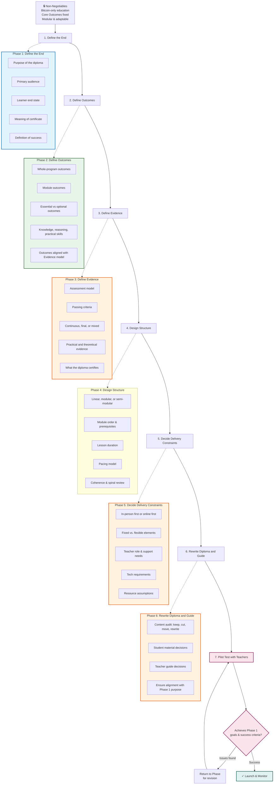

# BD_Redesign Workflow Diagram

# Diploma Redesign Workflow

## Legend

* **🔒 Non-Negotiables** — Constraints that apply to every phase
* **Phase 1–2** — Leadership and curriculum team define the vision
* **Phase 3–5** — Curriculum, pedagogy, and logistics take shape
* **Phase 6** — Full team writes/revises materials
* **Phase 7 (Validation)** — Pilot test against Phase 1 goals; loop back if needed

## Key Improvements

✅ **Non-Negotiables gate** — Sits above Phase 1, constrains all decisions\n✅ **Validation loop** — Phase 7 tests against Phase 1 success criteria; feeds back if needed\n✅ **Phase 5 clarification** — "Fixed vs. flexible elements" made explicit\n✅ **Phase 2 addition** — "Outcomes aligned with Evidence model" ensures Phase 2–3 alignment\n✅ **Phase 4 addition** — "Coherence & spiral review" added\n✅ **Phase 6 clarification** — Added "Ensure alignment with Phase 1 purpose"\n✅ **Color-coding** — Visual distinction between decision layers (optional; can be removed if not needed)\n✅ **Return loop** — If pilot testing fails, you return to the relevant phase—not back to square one

## Usage

1. Start at Non-Negotiables
2. Move linearly through Phases 1–6
3. Use Phase 7 to validate against Phase 1 goals
4. If issues found, return to the relevant phase for revision (not necessarily the beginning)
5. Once pilot succeeds, move to "Launch & Monitor"